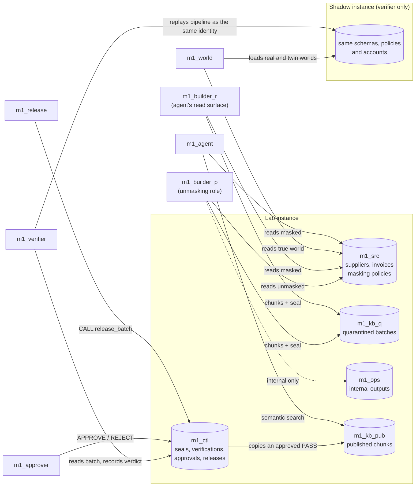
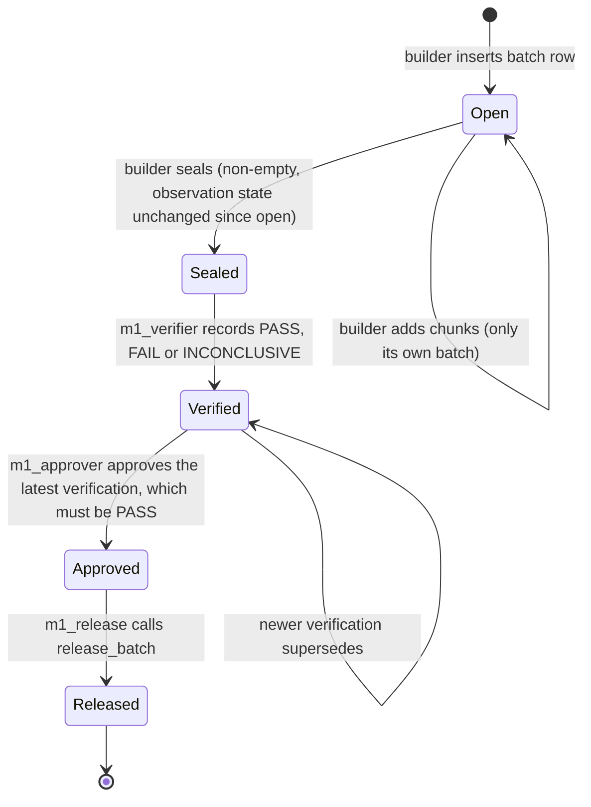
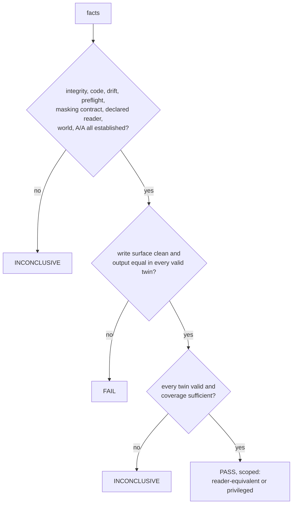

# M1 architecture

M1 puts a release gate between a knowledge-base pipeline and the AI agent
that reads its output. MySQL Enterprise Dynamic Data Masking protects the
agent's reads of the source tables; the gate decides whether a derived
knowledge base may reach the agent, and the database enforces that decision.

## Data flow

`m1_ops` holds what privileged processing writes for internal use (the
review queue of experiment P2). The agent cannot read it, so a difference
there is reported but does not change the verdict.

## Publication flow enforced by the database

Every arrow is checked by a trigger or by the release procedure, owned by
`m1_gate_def`, a locked account. All control tables are append-only.

| Step | Database check (refusal raises SQLSTATE 45000) |
|---|---|
| Open, add, seal | the batch builder is recorded from `USER()`; only that builder adds chunks or seals; an empty batch cannot be sealed; the seal records the content hash and the observation state, and is refused if the state changed during the build |
| Verify | only `m1_verifier`; batch sealed; a builder cannot verify its own batch; the recorded content hash equals the seal and the content recomputed now; the recorded observation state equals the current one; a PASS requires the verified code hash to be the batch code hash. (Whether the state still equals the sealed one is checked by the verifier, as the drift fact below, not by this trigger.) |
| Approve | only `m1_approver`; the verification belongs to the batch, is the latest one and is PASS; the approved hash equals the verified hash; the approver differs from builder and verifier |
| Release | only `m1_release`; latest verification is a PASS recorded by `m1_verifier` for the batch's code; latest approval approves exactly that verification; content hash recomputed and equal to the seal, the verification and the approval; observation state recomputed and equal to the verified one; the published copy rehashed and equal to the seal; all in one transaction |
| Published table | rows enter only through `release_batch` and must be sealed quarantine rows; published rows cannot be updated or deleted |
| Every attributing step | no anonymous account and no proxy mapping exists, because attribution relies on `USER()` |

Three hashes tie the flow together:

- **Content hash** of a batch: a SHA-256 chain over `(chunk_no, doc_key,
  content, embedding)` in chunk order, computed both in SQL
  (`m1_ctl.batch_hash`) and in Python, and compared on every verification.
  Batch ids and timestamps are excluded, so a shadow replay hashes the same.
- **Observation state hash** (`m1_ctl.observation_state_hash`): masking
  policy definitions, the source columns' metadata, role grants and default
  roles, static and dynamic privileges, proxy mappings, the three global role
  settings (`mandatory_roles`, `activate_all_roles_on_login` and
  `activate_mandatory_roles`; tag `m1-obs-v2`) and the definitions of the
  gate's own triggers and routines.
  It does not cover which policy each column is bound to (only visible
  through `SHOW CREATE TABLE`); the verifier checks bindings separately.
- **Code hash**: the pipeline sources plus the identity of the pinned
  embedding model. The verifier refuses to vouch for a batch built by other
  code.

## The verifier

The verifier never trusts the build's account of what it read. It gathers
facts and `decide()` turns them into a verdict.

| Fact | How it is established |
|---|---|
| integrity | SQL and Python content hashes of the quarantined rows agree with the seal |
| code | the batch code hash equals the hash of the code the verifier runs |
| drift | the lab observation state equals the sealed one, before and after the verification |
| preflight | the shadow instance replicates the lab's policies, bindings, roles and grants for the identities involved |
| masking contract | the declared policies and bindings are in force and the agent has no unmasking path |
| declared reader | if the builder is declared as the reader, the clearance checks C1–C6 hold |
| world | the true source, read by `m1_world`, is stable during the verification and loads faithfully into the shadow instance |
| A/A | two shadow replays on the real world reproduce the sealed hash |
| write surface (W) | the builder can write only into quarantine or internal schemas the agent cannot read, and holds nothing beyond SELECT and those inserts |
| twins | the published output is recomputed on each twin world |
| coverage | the twins changed enough masked cells to mean something |

A fact that could not be established blocks a PASS. When the masking
contract is not in force, for example, the verifier does not replay at all,
and world and A/A are reported as not established.

### Twin worlds

A twin is a copy of the source data that differs from the real one only in
masked cells. It is not assumed to be indistinguishable: each candidate twin
is loaded into the shadow instance and read back as the agent. A masked
cell whose agent-visible form changed is moved to its next candidate value;
when no candidate is left it keeps its original value and counts as not
covered. A twin whose agent view still differs is invalid. Three
permutation twins take values from other rows of the same column first;
three synthetic twins take generated values first. If the published output
changes in any valid twin, it depends on data the agent cannot see.

### Clearance checks (Build-as-Reader)

| Check | Holds when |
|---|---|
| C1 roles | every role the builder could activate (granted, latent, nested or mandatory) is one the agent holds; latent roles are reported |
| C2 global role activation | `mandatory_roles` empty and `activate_all_roles_on_login` OFF; `activate_mandatory_roles` is recorded but does not decide it (with no mandatory role it has no effect, and switching it off still leaves a mandatory role granted to every account, which `SET ROLE ALL` activates) |
| C3 DEFINER objects | no view, routine or trigger reachable by the builder runs as another definer, except the gate's own definer when it holds no role and reads no source |
| C4 effective identity | one account row for the user name, no anonymous account, no proxy grant, and a live login resolves to the account with no active role |
| C5 privileges | no global or dynamic privilege and nothing but SELECT and INSERT on objects; every read is also a read the agent has, apart from the builder's own batch rows |
| C6 observed equivalence | the source read as the builder equals the source read as the agent |
| C7 masking contract | policy definitions and column bindings equal the declared contract; the agent cannot reach the unmasking role and logs in with no active role |
| W write surface | every privilege other than SELECT is a data write into the quarantine tables or an internal schema the agent cannot read; any other privilege is a violation |

C1–C6 only set the scope of a PASS; they never grant one. C7 failing makes
the verdict INCONCLUSIVE; W failing makes it FAIL.

## The agent

`m1_agent` reads `m1_kb_pub.chunks` for the latest released batch, embeds
the question with the same pinned `BAAI/bge-small-en-v1.5` model (with the
retrieval instruction the model card recommends for queries) and ranks the
chunks by cosine similarity. It returns ranked chunks, not generated text,
so what it can say is exactly what was released.

## Trust boundaries

- The lab administrator deploys everything and can drop triggers. It is in
  the trusted computing base. The release procedure recomputes every hash,
  so content changed behind the triggers is refused, but an administrator
  who rewrites content, seal, verification and approval consistently is not
  detected by the database alone.
- The verifier code, the shadow instance and `m1_world` are trusted.
- Separation of duties is between accounts, not between people.
